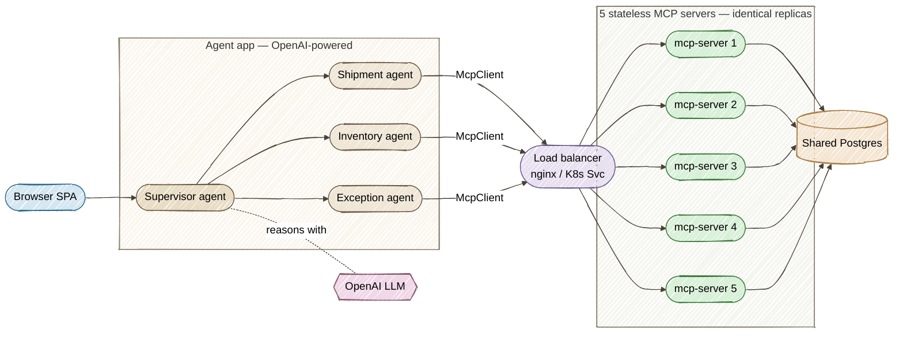
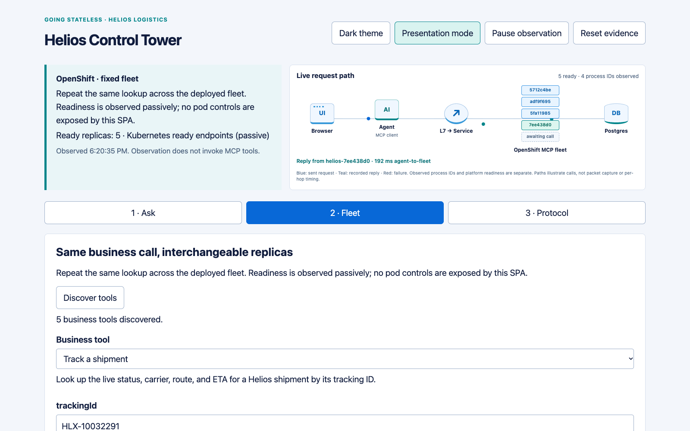
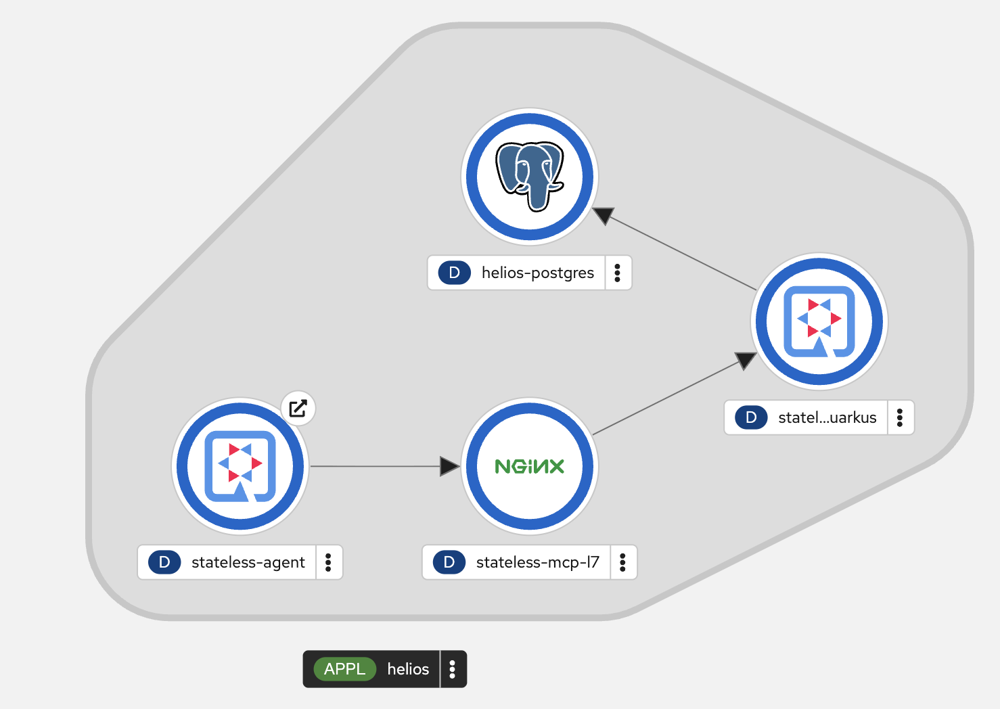
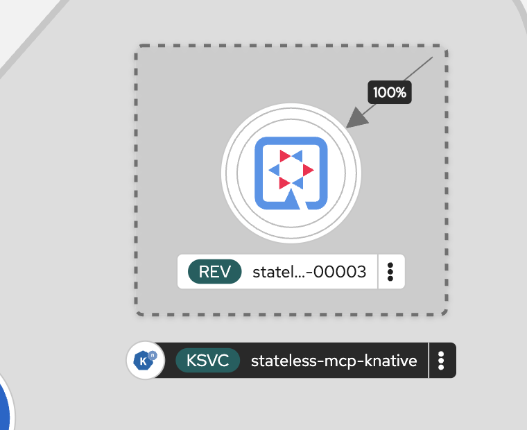

# Helios Control Tower — Agent + Stateless MCP Fleet on Quarkus

[](https://github.com/danieloh30/stateless-mcp-quarkus)
[](https://github.com/danieloh30/stateless-mcp-quarkus/actions)
[](.github/dependabot.yml)
[](.github/workflows/dependabot-auto-merge.yml)

A production-shaped demo of **stateless, cloud-native MCP (Model Context Protocol) servers** on
**Quarkus** / **Java 25**, fronted by a real **agentic** app — an **OpenAI-powered supervisor** that
routes plain-English questions to specialist sub-agents, each backed by the MCP fleet — with a
polished single-page console.

**Conference site:** <https://danieloh30.github.io/stateless-mcp-quarkus/>

---

## The enterprise scenario

**Helios Logistics** is a fictional global freight company. Its AI agents and ops teams query live
enterprise data — shipment tracking, warehouse inventory, lane pricing, carrier SLAs, open
exceptions. Instead of one stateful, session-heavy server, Helios runs a **fleet of stateless MCP
tool servers**, and a separate **agent** app talks to them:



The two tiers have clean responsibilities:

- **`agent/`** — the front door and the brains. Serves the console SPA and runs a real
  **agentic app**: a **`@SupervisorAgent`** (OpenAI-backed) routes each plain-English question to
  specialist **`@Agent` sub-agents** (shipment, inventory, exceptions), each holding a managed
  **`McpClient`** (`quarkus-langchain4j-mcp`) that speaks MCP to the fleet. The classic
  tool-catalog/invoke REST endpoints still exist for the console's raw "Run 5×" view.
- **`mcp-server/`** — pure MCP tool servers: `@Tool` methods + PostgreSQL lookups, no UI. Run as
  **5 identical stateless replicas** behind the load balancer.

Because the servers keep **zero** in-JVM state (all state lives in Postgres), each `tools/call` can
be served by any replica. The console's **“Run 5×”** shows the serving replica rotating while the
result never changes — real horizontal scaling, and the basis for **scale to zero**.

Statelessness is enabled with `quarkus.mcp.server.http.streamable.auto-init=true`: no `initialize`
handshake or session is required, so there's no affinity to pin a client to one replica.

### Why the agents use scoped `@ToolBox` bridges

Quarkus LangChain4j 1.13 supports putting `@McpToolBox("fleet")` directly on a declarative `@Agent`
method. That is the shortest way to expose every tool discovered from the named remote MCP client.
This demo deliberately keeps the small bridge classes under `agent/.../tools/` and attaches them with
`@ToolBox`, however, so each specialist receives only its domain tools: Shipment gets three,
Inventory one, and Exceptions one. Replacing those bridges with `@McpToolBox("fleet")` would give
every specialist all five remote tools. The MCP calls are remote in either design.

### Where `Mcp-Method` and `Mcp-Name` come from

They are standard Streamable HTTP request headers in MCP `2026-07-28`, not values configured in
`application.properties`, nginx, or the Knative manifest:

- `Mcp-Method` mirrors the JSON-RPC `method`, such as `tools/list`, `tools/call`, or
  `resources/read`.
- `Mcp-Name` mirrors the target in `params.name` for a tool/prompt or `params.uri` for a resource.
  For example, calling `getCarrierSla` sends `Mcp-Method: tools/call` and
  `Mcp-Name: getCarrierSla`.

The MCP server registers each Java method annotated with `@Tool`; absent an explicit annotation
name, its Java method name becomes the tool name. On the Agent side, `AgentService` creates a
`ToolExecutionRequest` with that name. The managed `McpClient` serializes the JSON-RPC body and its
Streamable HTTP transport automatically derives and sends the matching headers. Applications only
set these headers themselves when implementing a raw MCP HTTP client.

---

## MCP tools

| Tool | What it does | Example args |
|------|--------------|--------------|
| `getShipmentStatus` | Live status, carrier, route, ETA for a shipment | `HLX-10032291` |
| `getWarehouseInventory` | On-hand / reserved / available stock for a SKU | `SKU-COLD-4521` |
| `estimateDelivery` | Transit days & cost for a lane between two hubs | `FRA → YYZ, 620 kg` |
| `getCarrierSla` | On-time %, transit days, damage rate for a carrier | `HELIOS-AIR` |
| `listOpenExceptions` | Shipments needing operator attention in a region | `APAC` |

Arguments are hardened with Jakarta Bean Validation (`@Pattern`, `@Positive`, `@Size`) — malformed
input is rejected before any DB lookup. (A `getServerInstance` tool also exists, used by the console
to reveal which replica served a request.)

---

## Ask the agent (natural language)

The console's **“💬 Ask the Agent”** card posts a plain-English question to `POST /agent/ask`. The
OpenAI-powered **supervisor** decides which specialist sub-agent(s) to call, each pulls live data
from the stateless MCP fleet, and the supervisor returns a synthesized answer:

```bash
curl -s localhost:8090/agent/ask -H 'content-type: application/json' \
  -d '{"question":"Where is shipment HLX-10032291 and will it arrive on time?"}'
# → {"answer":"HLX-10032291 is in transit with HELIOS-AIR on the FRA→YYZ lane, ETA ..."}
```

Try things like *“How much stock of SKU-COLD-4521 is available?”*, *“Estimate delivery from FRA to
YYZ for 620 kg”*, or *“What exceptions are open in APAC?”* The raw tool-catalog / `Run 5×` view still
lives alongside it for the statelessness demo.

| Sub-agent | Specialty | MCP tools it uses |
|-----------|-----------|-------------------|
| `ShipmentAgent` | Tracking, delivery/lane estimates, carrier SLAs | `getShipmentStatus`, `estimateDelivery`, `getCarrierSla` |
| `InventoryAgent` | Warehouse stock questions | `getWarehouseInventory` |
| `ExceptionAgent` | Shipments needing operator attention | `listOpenExceptions` |

---

## Run it — dev mode (two processes)

Prerequisites: **Java 25+**, the **Quarkus CLI**, **Docker** or **Podman** (for the database), and an
**`OPENAI_API_KEY`** (the agent's supervisor + sub-agents call OpenAI). The model defaults to
`gpt-5.6-sol` and is overridable with **`HELIOS_LLM_MODEL`** (a mini model works fine too).

If the `quarkus` command is not installed, install the CLI with one of these options (see the
[official Quarkus CLI guide](https://quarkus.io/guides/cli-tooling)):

```bash
brew install quarkusio/tap/quarkus  # Homebrew (macOS/Linux)
sdk install quarkus                 # SDKMAN! (macOS/Linux)
jbang app install --fresh --force quarkus@quarkusio  # JBang (cross-platform)
quarkus --version                   # verify
```

```bash
export OPENAI_API_KEY=sk-...          # required for the "Ask the Agent" flow
export HELIOS_LLM_MODEL=gpt-5.6-sol   # optional — defaults to this
```

Run each command **from its module directory**:

```bash
# Terminal 1 — the MCP server. Dev Services auto-starts a throwaway PostgreSQL
# (seeded from import.sql) and serves MCP on :8080.
cd mcp-server
quarkus dev

# Terminal 2 — the agent (console + supervisor/sub-agents) on :8090, pointing at :8080.
# Open a second terminal at the repository root. Reads OPENAI_API_KEY from your shell.
cd agent
quarkus dev
```

Open the console at **<http://localhost:8090/>**. In dev there is one MCP server, so “Run 5×” shows
a single replica — one server; it is not a multi-replica proof.

Other endpoints: MCP at `http://localhost:8080/mcp`, health at `/q/health` on each app.

**Opening `localhost:8080` in dev mode shows the MCP server's Dev UI, not the console SPA.**
The SPA is served by the `agent` process at `http://localhost:8090/`; starting only `mcp-server`
does not start the agent. The cluster setup below uses port `8080` for the SPA instead.

Dev mode stays in the foreground while serving requests. Use the lowercase **`h`** key for
shortcuts and **`w`** to open the current module's web page. The parent POM disables JLine's
terminal probing in dev mode because it can interfere with Quarkus's keyboard input. Restart
any dev process started before this setting was added so it takes effect.
Check `curl http://localhost:8080/q/health/ready` to distinguish a terminal issue from a server
startup failure. Export `OPENAI_API_KEY` in the **agent's terminal** before starting it; a missing
key prevents the agent and SPA from starting.

## Run it — the cluster (see real statelessness)

Launch the full topology — **agent → LB → 5 stateless MCP replicas → shared Postgres**:

```bash
./start-cluster.sh      # builds both images, starts everything
open http://localhost:8080
# Pick a tool → "Run 5×" → the serving replica rotates across all 5, results identical.
./stop-cluster.sh       # tear down
```

## Package & native

```bash
./mvnw clean package                 # builds both modules
./mvnw clean package -Dnative        # GraalVM native — measure native startup and memory for your workload
```

The project uses **Quarkus 3.40.1.2** while MCP Server 2.1.0 depends on the Quarkus 3
Jackson API. Dependabot temporarily excludes Quarkus 4 platform updates after the
[`ObjectMapperCustomizer` failure in PR #28](https://github.com/danieloh30/stateless-mcp-quarkus/pull/28).
The [Quarkus 4 compatibility workflow](.github/workflows/quarkus4-readiness.yml) runs
daily at 06:30 Eastern and supports manual runs. It selects the latest stable Quarkus 4
version shared by both platform BOMs and the Maven plugin, plus the latest stable MCP
Server release, then runs `clean verify` in a temporary copy. Logs, candidate POMs and
test reports are uploaded as workflow artifacts.

Scheduled and manual checks remain red while blocked. PR checks accept only the known
MCP class-loading failure; other regressions and monitor errors fail. A green compatibility
probe requires both existing module suites and packaging to pass. If the MCP blocker
disappears but application migration is still needed (including the agent's Jackson API),
the check reports a regression. Review the evidence and complete that migration before
removing the restriction in `.github/dependabot.yml`; the monitor does not merge upgrades.

## Deploy to OpenShift / Kubernetes (native + scale-to-zero)

The `quarkus-openshift` extension generates the application manifests at build time. The **agent**
gets a Route (external); the **MCP servers** stay internal. An internal nginx L7 proxy makes
per-request rotation visible even though an OpenShift Service normally balances per TCP connection.
The SPA reports ready pods separately from replicas observed serving requests, using a headless
discovery Service. The agent finds the proxy at `http://stateless-mcp-l7/mcp` (override with
`MCP_FLEET_URL`), and the datasource comes from
the `helios-db` Secret — no secrets in the image.

### Step 1 — Log in and pick a project

```bash
oc login ...            # cluster-admin (Step 2 installs a cluster-scoped operator)
oc new-project helios
```

### Step 2 — Install OpenShift Serverless (once, for scale-to-zero)

Required only for the Knative scale-to-zero step below. The script installs the operator and enables
Knative Serving, waiting until both are ready:

```bash
./install-serverless.sh   # applies k8s/serverless-operator.yaml + k8s/knative-serving.yaml
```

### Step 3 — Build images and deploy the apps + database

```bash
export OPENAI_API_KEY=sk-...   # required; stored in Secret/helios-openai
./deploy-openshift.sh          # JVM images (portable default)
./deploy-openshift.sh native   # optional: requires a matching native-build environment
```

This applies the shared PostgreSQL (`k8s/postgres.yaml`) and deploys both modules. Generated
manifests land in each module's `target/kubernetes/`.

The deployment script requires `oc` and `jq`. In JVM mode it creates the build resources,
imports and verifies the required Java builder image tag before starting each OpenShift S2I
build, uploads each packaged application, then applies its Deployment
with the published image digest. Application pods start only after their image exists;
local Podman is not needed for this image build. A failed build or rollout stops the script.

The script idempotently creates or refreshes `Secret/helios-openai` from the exported key. The
generated Agent Deployment imports that Secret as `OPENAI_API_KEY`; the key is never baked into an
image. If the variable is not exported, an existing Secret is reused, or deployment stops with a
clear error when neither is available.

### Step 4 — Scale the stateless fleet

No session affinity, so scaling is just a number:

```bash
oc scale deploy/stateless-mcp-quarkus --replicas=8
```

The SPA shows platform readiness separately from replicas actually observed serving requests:



*Helios Control Tower in fixed-fleet mode with eight ready MCP replicas.*



*OpenShift Developer Topology in regular mode: Agent → nginx L7 proxy → stateless MCP Deployment
→ PostgreSQL.*

### Step 5 — Scale to zero with Knative (the stateless payoff)

Switch the Agent from the fixed Deployment/L7 fleet to a cluster-local Knative Service
(`minScale: 0`) backed by the same MCP image and PostgreSQL database:

```bash
./knative-mode.sh enable
oc get pod -l serving.knative.dev/service=stateless-mcp-knative -w
```

After the last request and Knative's idle window, the MCP pod count falls to zero. The SPA's
three-second readiness check uses a passive headless Service and therefore does not wake it. Invoke
a tool in the SPA to cold-start the MCP server and watch the ready count rise again. A native image
starts faster, but the flow also works with the default portable JVM image. While this mode is
active, the Agent probe checks the Agent itself rather than issuing an MCP discovery request every
ten seconds, and the MCP client's one-minute automatic heartbeat is disabled; otherwise that health
traffic would deliberately keep Knative warm. Passive instance polling is also blocked server-side,
so even a browser tab opened before the mode switch cannot keep the MCP revision running.



*OpenShift Developer Topology groups the Quarkus Revision under its Knative Service; the objects
remain visible even after the revision's pod count reaches zero.*

Return to the regular L7-balanced fleet (restoring its previous replica count) with:

```bash
./knative-mode.sh disable
```

> Demo flow for the talk: **dev (2 processes) → local cluster (`./start-cluster.sh`, 5 replicas
> round-robin) → OpenShift native → Knative scale-to-zero.**

---

## Automated dependency upgrades

- **`.github/dependabot.yml`** — **daily** Maven (`io.quarkus*`, `io.quarkiverse.mcp*`, grouped) and
  GitHub Actions checks.
- **`.github/workflows/dependabot-auto-merge.yml`** — builds/tests each Dependabot PR, then
  **auto-merges** only if it passes. PRs that change `.github/workflows/` require a
  maintainer to merge because the workflow's `GITHUB_TOKEN` cannot update workflow files.

## GitHub Pages

The conference-friendly site is generated directly from this README, so setup instructions stay in
one place. Every documentation change on `main` is published by
[`pages.yml`](.github/workflows/pages.yml).

Preview it locally before presenting:

```bash
python3 -m pip install -r requirements-docs.txt
./scripts/preview-pages.sh
```

Then open <http://127.0.0.1:8000/>. The first repository setup may require selecting **GitHub
Actions** under **Settings → Pages → Build and deployment → Source**.

## Project layout

```
stateless-mcp-quarkus/               (parent / aggregator pom)
├── mcp-server/                      # stateless MCP tool servers (run as 5 replicas)
│   ├── src/main/java/dev/helios/
│   │   ├── tools/ShipmentTools.java #   @Tool methods (+ getServerInstance)
│   │   ├── service/                 #   ShipmentService (Panache) + InstanceInfo
│   │   ├── domain/                  #   JPA entities
│   │   └── model/                   #   response records
│   ├── src/main/resources/          #   application.properties, import.sql
│   ├── src/main/docker/Dockerfile.jvm
│   └── src/test/java/...HeliosMcpTest.java   # tests over /mcp
├── agent/                           # agentic app + console (the front door)
│   ├── src/main/java/dev/helios/agent/
│   │   ├── agents/                  #   @SupervisorAgent + @Agent sub-agents
│   │   │   ├── HeliosSupervisor.java     #     routes NL questions to sub-agents
│   │   │   ├── ShipmentAgent.java        #     shipment / inventory / exception,
│   │   │   ├── InventoryAgent.java       #     each with a @ToolBox
│   │   │   └── ExceptionAgent.java
│   │   ├── tools/                   #   @Tool bridges: sub-agent → MCP fleet
│   │   │   ├── ShipmentToolbox.java
│   │   │   ├── InventoryToolbox.java
│   │   │   └── ExceptionToolbox.java
│   │   ├── service/AgentService.java #   managed McpClient → the fleet
│   │   ├── rest/AgentResource.java  #   REST the SPA calls (/agent/*, /agent/ask)
│   │   └── dto/                     #   AskRequest / AskResult / InvokeResult records
│   ├── src/main/resources/
│   │   ├── application.properties
│   │   └── META-INF/resources/index.html   # the console SPA
│   └── src/main/docker/Dockerfile.jvm
├── compose.yml                      # postgres + 5 mcp replicas + nginx LB + agent
├── compose/ (init.sql, nginx.conf)
├── k8s/
│   ├── postgres.yaml               # shared Postgres (Secret + Deployment + Service)
│   ├── serverless-operator.yaml    # OpenShift Serverless operator (OLM)
│   ├── knative-serving.yaml        # KnativeServing CR (enables scale-to-zero)
│   └── knative-service.yaml        # the MCP fleet as a scale-to-zero Knative Service
├── start-cluster.sh / stop-cluster.sh / knative-mode.sh
├── install-serverless.sh / deploy-openshift.sh
└── .github/                         # Dependabot + build-gated auto-merge
```

Built with [Quarkus](https://quarkus.io), the
[Quarkus MCP Server](https://github.com/quarkiverse/quarkus-mcp-server), and
[Quarkus LangChain4j](https://docs.quarkiverse.io/quarkus-langchain4j/dev/) (agentic `@Agent` /
`@SupervisorAgent` + MCP client, on OpenAI).


## Presenter console: environment impact

The launch sequence stays **dev mode → `./start-cluster.sh` → OpenShift → `./knative-mode.sh enable`**.
The app identifies its stage; packaged OpenShift mode is the default, Compose sets `HELIOS_DEMO_ENVIRONMENT=compose`, and Quarkus dev/test profiles select `dev`.

| Capability | Dev | Local cluster | OpenShift fleet | Knative |
| --- | --- | --- | --- | --- |
| Ask + actual specialist-tool trace | Yes, with API key | Yes | Yes | Yes, may activate fleet |
| Direct business lookup + protocol evidence | Yes | Yes | Yes | Yes, explicitly activates fleet |
| Repeat selected lookup five times | Disabled: single instance | Yes | Yes | Yes; compares first and subsequent calls |
| Readiness observation | Unknown unless configured | DNS address estimate | Ready endpoints from Kubernetes API | Ready endpoints from Kubernetes API |
| Opening the SPA discovers MCP tools | Yes | Yes | Yes | No: discovery is explicit |
| Dynamic topology and request/reply animation | Yes, direct path | Yes, L7 + five slots | Yes, L7 + observed processes | Yes, Knative + zero-ready state |
| Presentation mode, reset, pause observation | Yes | Yes | Yes | Yes |
| Platform scale-to-zero | No | No | No | Requires Knative configuration |

**Ask** shows the answer and actual executed tool bridges (specialist, arguments, result, serving replica). The response trace is scoped to the question ID, and its temporary collection is removed afterward. The framework monitor retains at most eight recent sessions in memory. No hidden model reasoning is exposed. Questions are bounded to 2,000 characters, at most two can execute concurrently, and the HTTP operation has a 90-second application deadline.

**Fleet** repeats a *business tool*, not `getServerInstance`. Diagnostic evidence lives in MCP result `_meta["dev.helios/evidence"]`; it is separate from the business fields used for comparison and is stripped from the text returned to the LLM. Matching results do not guarantee every replica was visited. Calls are sequential; the UI retains failed attempts and distinguishes ready endpoints from observed serving instances.

**Protocol** displays allowlisted headers and a logical request captured at tool execution. It is not a packet capture: HTTP proxy headers, credentials, and unrelated metadata are deliberately excluded. The displayed observed version and transient-connection flag come from the serving MCP server. Protocol tests separately assert that modern responses do not mint `Mcp-Session-Id`. The SDK strips metadata when it throws a tool error; those errors remain typed, but the UI correctly reports no replica/protocol evidence for them.

**Knative** observations use the Kubernetes API, not the MCP endpoint. `k8s/mcp-l7-proxy.yaml`, already applied by the deployment script, creates `helios-agent` and a namespace-scoped role permitting only `get` on the two named headless-service Endpoints objects. A zero-ready-endpoint count does not itself prove zero running pods: confirm that in the OpenShift console. Authentication, DNS, or API failures display **unknown**, never an invented zero. A recent zero-ready observation followed by invocation is labeled as an end-to-end activation measurement, not pure JVM startup time.

Pause stops SPA observation only. In serverless mode, retain the existing heartbeat suppression and Agent probe change in `knative-mode.sh`; other tabs and clients can still generate traffic. Discovery is intentionally user-triggered when the page opens in Knative mode.

### Fifteen-minute rehearsal

1. **Dev, 0–3 min:** one question, its actual tool trace, then the Protocol view and an invalid tracking ID.
2. **Local cluster, 3–7 min:** repeat the same business lookup; compare results and serving replicas. Optionally replace a replica from the terminal and repeat.
3. **OpenShift/Knative, 7–13 min:** show platform readiness, enable serverless, observe idle behavior, then invoke and compare first/subsequent timings.
4. **13–15 min:** buffer. Build images and prepare the cluster before presenting.

### Verification

`./mvnw verify` exercises valid modern discovery/calls, same-call evidence, tool validation, missing headers, header/body mismatches, and SPA startup/environment metadata. As before, server tests need a container runtime for the database, or an explicit test datasource.

Optional browser checks (no frontend build step is needed to run the app):

```bash
npm ci
npx playwright install chromium
npm run test:spa
```

These checks use isolated API fixtures for dev, Compose, OpenShift and Knative. They exercise actual selected-tool repetition, result comparison, safe rendering, duplicate submission protection, explicit serverless discovery, and paused observation. They do not replace verification against a running fleet. To use an installed Chrome, set `PLAYWRIGHT_CHROMIUM_EXECUTABLE` to its executable path.

The top-right topology follows explicit browser requests and completed tool replies. Blue markers indicate outbound actions, teal indicates recorded replies, and red indicates failures. A replica is highlighted only from same-call server evidence. AI questions animate the Browser → Agent leg while pending; their completed tool paths appear when the monitored trace returns. This is application-level visualization, not packet capture or per-hop timing. In Knative mode, zero ready endpoints are drawn as an idle outline, while historical observed-process counts remain separate. Repeated calls have a 1.2-second visual pause between them, excluded from each recorded call duration. All three SDK list-change subscriptions (tools, prompts, resources) are disabled; an unused subscription stream can otherwise keep a Knative revision active. The visualization never polls or wakes the MCP fleet itself and respects reduced-motion preferences.
