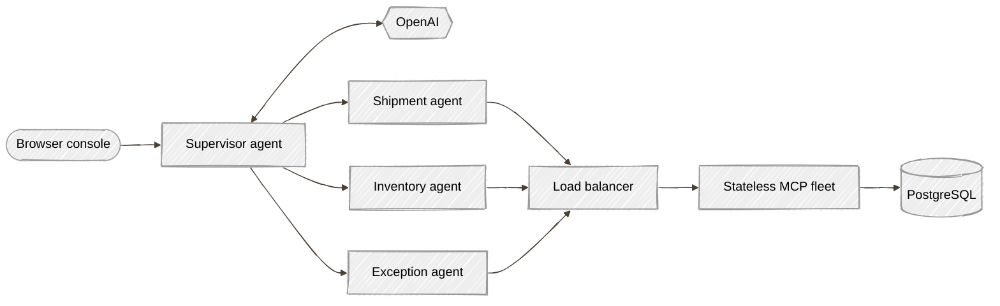

# Architecture

Helios separates reasoning from tool execution. The agent tier owns conversation and delegation; the MCP tier owns validated access to enterprise data.

## Request lifecycle

1. A user asks a plain-English question in the console.
2. The OpenAI-backed supervisor selects the right specialist.
3. That specialist sees only its scoped MCP tools through a `@ToolBox` bridge.
4. The managed MCP client sends a Streamable HTTP request through the load balancer.
5. Any healthy replica validates the input, queries PostgreSQL, and returns the result.

## Specialist boundaries

| Specialist | Responsibility | Available MCP tools |
| --- | --- | --- |
| Shipment | Tracking, lane estimates, carrier SLAs | `getShipmentStatus`, `estimateDelivery`, `getCarrierSla` |
| Inventory | Warehouse stock | `getWarehouseInventory` |
| Exception | Operator attention queues | `listOpenExceptions` |

The explicit toolbox bridges are intentional. Giving every specialist the entire remote catalog would be shorter, but it would also widen each agent's authority.

## Why stateless MCP matters

Both tiers explicitly use **MCP 2026-07-28**, with no protocol sessions. Calls carry their own protocol context, and the MCP server reports transient connections. Streamable HTTP existed before this revision; the absence of protocol sessions does not make the transport JSON-only or rule out request-scoped SSE.

The application keeps durable business data in shared PostgreSQL. Interchangeable replicas can handle independent requests without session affinity. Database connections, downstream APIs, tenant boundaries, and durable state still need their own design. Knative enables scale-to-zero through autoscaler configuration; startup time and active streams affect the result.

## Evidence and live topology

A server guardrail attaches demo evidence to each tool result in `_meta["dev.helios/evidence"]`: the serving process ID, uptime, transient-connection flag, allowlisted MCP headers, and the logical request. It does not copy authorization headers. The agent separates that evidence from the business result, so comparing replicas does not compare process IDs or timings.

Natural-language answers include actual monitored specialist tool executions correlated to a unique question ID. Tool evidence stays in execution attributes rather than the text sent to the model. Temporary trace collection is removed after each request; the framework's recent monitored-session history is bounded to eight sessions.

The topology animates browser actions and confirmed replies. It highlights a process only when same-call evidence identifies it. AI tool paths are shown after the completed trace arrives. Paths and animation speed do not measure individual network hops. SDK-returned tool errors may omit metadata; the UI reports the error without inventing a serving replica.

Readiness is observed independently: Compose uses a DNS address estimate, while OpenShift uses a read-only, namespace-scoped role to retrieve two named Kubernetes Endpoints resources. Dev mode and observation failures report unknown rather than inventing a count. Ready endpoints, observed process IDs, and running pods are different measurements.

## Tool boundary

Typed tool parameters describe the contract. Explicit service checks validate identifiers, sizes, and values before database access. Invalid business inputs become structured MCP tool errors; transport failures remain distinct failures.

The MCP client also derives standard `Mcp-Method` and `Mcp-Name` headers from each JSON-RPC request, giving gateways enough context for method- and tool-aware routing or policy.
