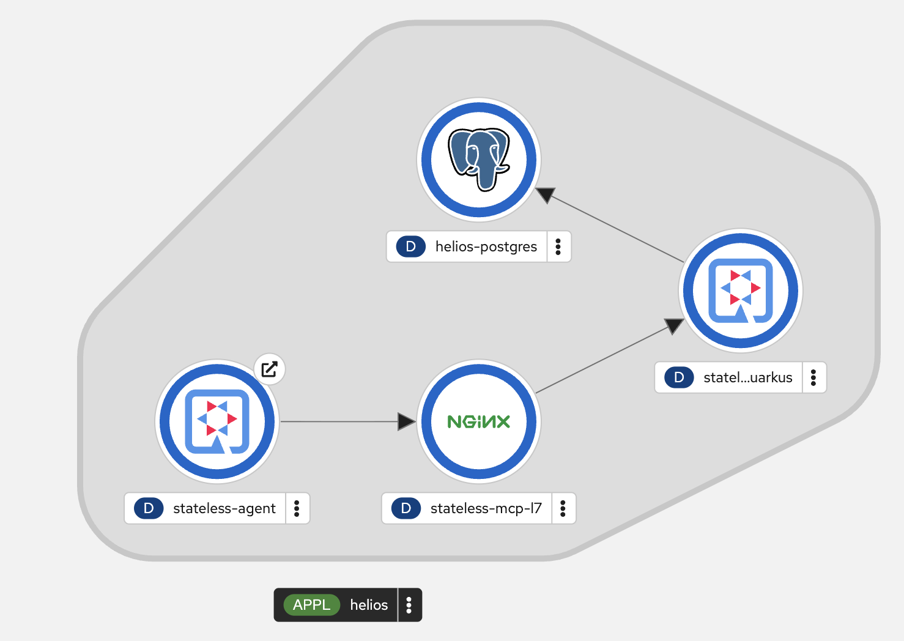
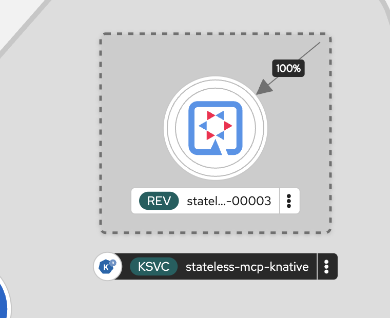

# Deployment

Move from a fixed OpenShift fleet to Knative scale-to-zero while keeping the agent endpoint stable.

## 1. Select a project

```bash
oc login ...
oc new-project helios
```

Cluster-admin access is needed only when installing the cluster-scoped Serverless operator.

## 2. Install OpenShift Serverless

```bash
./install-serverless.sh
```

The script applies the operator and Knative Serving resources, then waits for both to become ready.

## 3. Deploy the platform

```bash
export OPENAI_API_KEY=sk-...
./deploy-openshift.sh
```

Use `./deploy-openshift.sh native` for a native build in a compatible build environment. The API key is stored in `Secret/helios-openai`; it is never baked into an image.

Install `oc` and `jq` before running the script. JVM images are built inside OpenShift from
the packaged applications, without local Podman. The script waits for each image build,
pins the Deployment to the published digest, and waits for readiness before continuing.
Build and rollout failures stop deployment instead of reporting success.

## 4. Prove horizontal scaling

```bash
oc scale deploy/stateless-mcp-quarkus --replicas=8
```

Open **2 · Fleet** and select **Repeat 5 calls**. The console distinguishes platform ready endpoints from process IDs observed in completed tool calls and compares the returned business results. Five calls do not guarantee five distinct replicas. The topology adapts to the observed fleet size; scaling and routing remain platform responsibilities.



## 5. Switch to scale-to-zero

```bash
./knative-mode.sh enable
oc get pod -l serving.knative.dev/service=stateless-mcp-knative -w
```

The switch disables the MCP client's periodic health traffic and changes the agent readiness probe to its own liveness endpoint. All three SDK list-change subscriptions—tools, prompts, and resources—are disabled in the application configuration; an unused notification stream can otherwise keep the revision active.

Keep the SPA open while the service idles. Its background observation reads platform metadata without calling the MCP fleet. In Knative mode, opening a fresh page does not automatically discover tools; **Discover tools (may activate fleet)** is an explicit action that can wake the service. You can discover tools first, then wait for the next idle period before invoking one.

After the configured idle window, confirm zero running MCP pods in OpenShift. Zero ready endpoints alone does not establish zero running pods. The topology shows zero readiness separately from the last recorded replica reply.

From a recent zero-ready observation, select **Repeat 5 calls** to measure the first invocation and subsequent calls. These are end-to-end measurements that include network and activation costs, not pure JVM startup times. Autoscaler settings, startup, downstream connections, and active streams affect scale-to-zero and activation.



Return to the regular fleet and restore its previous replica count:

```bash
./knative-mode.sh disable
```

!!! tip "Conference demo sequence"
    Dev mode → five-replica local cluster → OpenShift fleet → Knative scale-to-zero.

## Where the SPA changes apply

The Ask, Fleet, Protocol, and animated topology views apply to every environment. The same demo commands remain in use.

- **Dev mode:** a direct MCP path and one server; repeated fleet calls are disabled and platform readiness is unknown.
- **Local cluster:** nginx routing, five configured slots, a DNS address estimate, and actual serving-process evidence.
- **OpenShift:** L7/Service routing, passive Kubernetes endpoint readiness, and actual serving-process evidence.
- **Knative:** serverless routing, explicit discovery, zero-ready and historical-reply displays, and first-after-zero versus subsequent call timing. Background observation does not activate the fleet.
